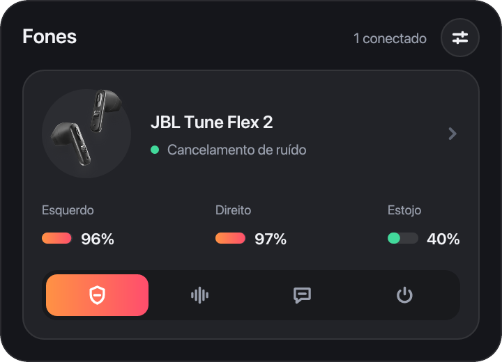
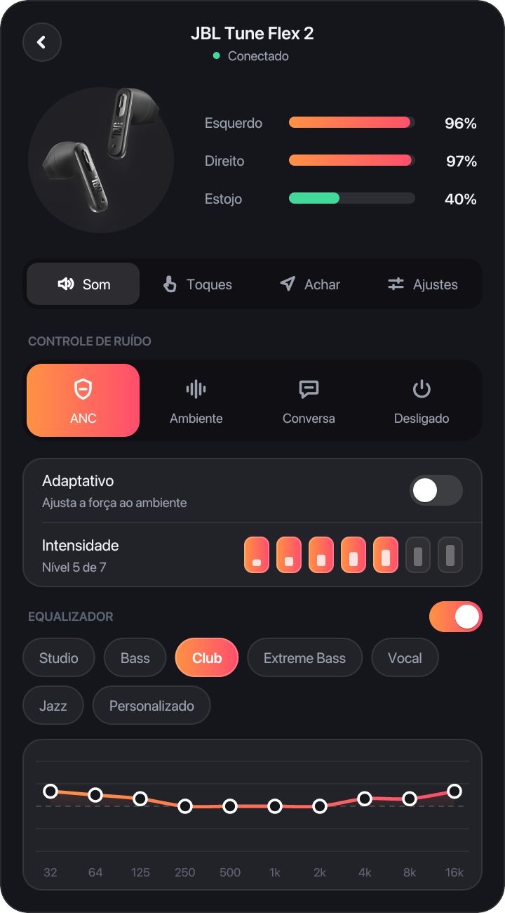
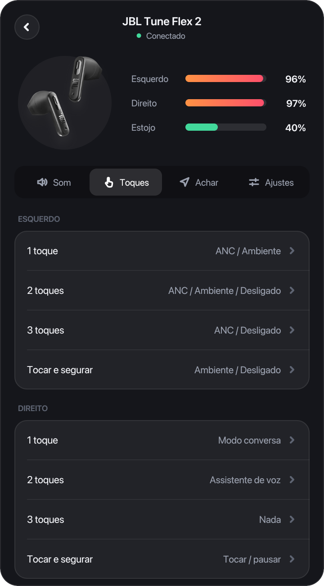
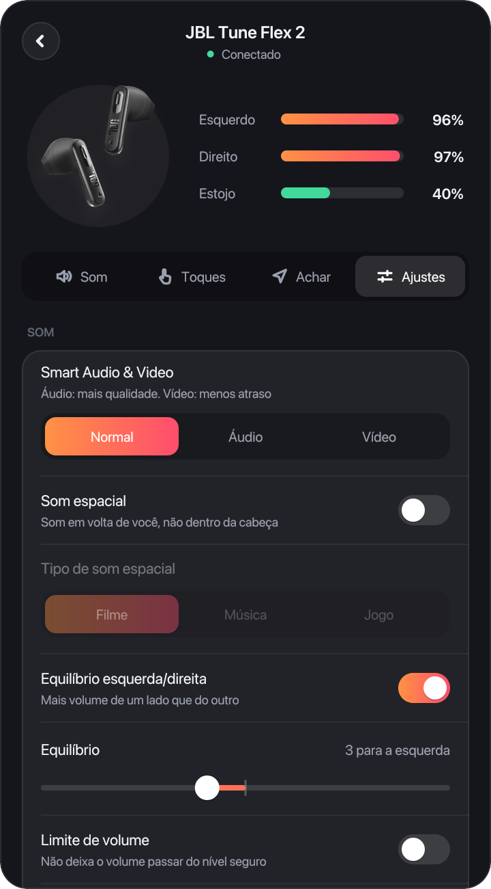

# OpenHeadphones

**Open source app for JBL headphones on Windows, macOS and Linux.** Not an official JBL app.

[](LICENSE)
[](https://github.com/edsuuu/OpenHeadphones/releases/latest)
[](https://github.com/edsuuu/OpenHeadphones/actions/workflows/build.yml)

**Control your JBL earbuds and headphones from the computer:** battery, noise cancelling (ANC),
ambient sound, equalizer with JBL's own presets, touch gestures, find my buds and the device
settings, from the system tray or the menu bar, without the phone app.

**Controle seus fones JBL pelo computador:** bateria, cancelamento de ruído, modo ambiente,
equalizador com os presets da JBL, gestos de toque, localizar o fone e os ajustes do próprio fone,
na bandeja do Windows e do Linux ou na barra de menus do Mac, sem o app do celular.

<p align="center">
  
  <br><sub>JBL Tune Flex 2 · <a href="https://edsuuu.github.io/OpenHeadphones/">site and video / site e vídeo</a></sub>
</p>

> [!IMPORTANT]
> **Not affiliated with JBL or Harman.** This is an independent, open source project, made to
> support JBL headphones on the desktop. It is not made, endorsed or supported by JBL or Harman
> International. JBL is a trademark of Harman International Industries.
>
> **Sem afiliação com a JBL ou a Harman.** Este é um projeto independente e de código aberto,
> feito para dar suporte aos fones JBL no computador. Não é feito, aprovado nem mantido pela JBL
> ou pela Harman International. JBL é marca registrada da Harman International Industries.

| Lista | Som | Toques | Ajustes |
| :---: | :---: | :---: | :---: |
|  |  |  |  |

## Download / Baixar

From the [latest release](https://github.com/edsuuu/OpenHeadphones/releases/latest)
(direct links below) or with one command on macOS and Linux:

```bash
curl -fsSL https://edsuuu.github.io/OpenHeadphones/install.sh | sh
```

| System | File |
| --- | --- |
| **macOS 15+** (Apple Silicon and Intel) | [jbl-headphones-mac.zip](https://github.com/edsuuu/OpenHeadphones/releases/latest/download/jbl-headphones-mac.zip) |
| **Windows 10/11** (x64) | [jbl-headphones-windows-x64.zip](https://github.com/edsuuu/OpenHeadphones/releases/latest/download/jbl-headphones-windows-x64.zip) |
| **Linux .deb** (Ubuntu, Debian, Mint, Pop!\_OS) | [amd64](https://github.com/edsuuu/OpenHeadphones/releases/latest/download/jbl-headphones-linux-amd64.deb) · [arm64](https://github.com/edsuuu/OpenHeadphones/releases/latest/download/jbl-headphones-linux-arm64.deb) |
| **Linux .tar.gz** (any distro with BlueZ) | [x64](https://github.com/edsuuu/OpenHeadphones/releases/latest/download/jbl-headphones-linux-x64.tar.gz) · [arm64](https://github.com/edsuuu/OpenHeadphones/releases/latest/download/jbl-headphones-linux-arm64.tar.gz) |

- **macOS:** unzip and drag *OpenHeadphones.app* to Applications. The app is not notarized by
  Apple: the first time, open it, then go to **System Settings → Privacy & Security → Open Anyway**.
  (The `curl` install above skips this step.)
- **Windows:** unzip anywhere and run `jbl-headphones.exe`.
- **Linux:** `sudo apt install ./jbl-headphones-linux-amd64.deb`, or unzip the `.tar.gz` and run
  `./jbl-headphones`.

The app updates itself when it starts (it can be turned off in the settings button at the top of
the list). The `.deb` only tells you a new version exists: install the new `.deb` over it.

## Português

### O que faz

- Mostra só os fones JBL **conectados a este computador**, com a bateria de cada lado e do estojo.
- Cancelamento de ruído (ANC), adaptativo e por nível, modo ambiente, conversa e desligado.
- Equalizador com os presets da JBL (Studio, Bass, Club, Extreme Bass, Vocal, Jazz) e personalizado.
- Gestos de toque de cada lado, localizar o fone (toca um som), Smart Audio & Video, som espacial,
  equilíbrio, limite de volume, desligamento automático e os demais ajustes do modelo.
- Em português e inglês, conforme o idioma do sistema.

### Instalar

Baixe o arquivo do seu sistema na tabela acima, ou no Mac e no Linux rode o comando `curl`.

- **Mac:** o app não é autenticado pela Apple. Na primeira vez, abra-o e depois vá em
  **Ajustes do Sistema → Privacidade e Segurança → Abrir Mesmo Assim**. Instalando pelo `curl`
  esse passo não é necessário.
- **Windows:** extraia o zip e abra `jbl-headphones.exe`.
- **Linux:** `sudo apt install ./jbl-headphones-linux-amd64.deb` (ou `arm64`), ou extraia o
  `.tar.gz` e rode `./jbl-headphones` (precisa do BlueZ).

O app se atualiza sozinho ao abrir; dá para desligar no botão de ajustes, no topo da lista de
fones. Pelo `.deb` ele só avisa que há versão nova: instale o `.deb` novo por cima.

### Fones

Os perfis de 44 modelos estão em [`devices/`](devices), gerados do app oficial da JBL por
`tools/import_jbl_apk.py`. O testado de ponta a ponta é o **JBL Tune Flex 2**; nos outros, o que
funciona depende de o modelo falar o mesmo protocolo. Testou outro modelo? Abra uma issue contando.

## English

### Features

- Shows only the JBL headphones **connected to this computer**, with left, right and case battery.
- Noise cancelling (ANC), adaptive and by level, ambient sound, talk-thru and off.
- Equalizer with JBL's presets (Studio, Bass, Club, Extreme Bass, Vocal, Jazz) and a custom one.
- Touch gestures for each side, find my buds, Smart Audio & Video, spatial sound, balance, volume
  limit, auto power off and the rest of each model's settings.
- English and Portuguese, following the system language.

### Supported headphones

Profiles for 44 models live in [`devices/`](devices), generated from JBL's official app by
`tools/import_jbl_apk.py`. Tested end to end: **JBL Tune Flex 2**. On the others, what works
depends on the model speaking the same protocol. Tried another model? Open an issue.

JBL Endurance Pace, Endurance Peak 4, Endurance Run 3 Wireless, Endurance Zone, Junior Free,
Live 680NC, Live 780NC, Live Beam 3, Live Beam 4, Live Buds 4, Live Flex 3, Live Flex 4,
Sense Lite, Sense Pro, Smart Tx, Soundgear Clips, Tour One M3, Tune 135BT, Tune 235BT, Tune 255NC,
Tune 520BT2, Tune 530BT, Tune 535BT, Tune 680NC, Tune 730BT, Tune 735BT, Tune 780NC, Tune 785NC,
Tune Beam 2, Tune Beam 3, Tune Buds 2, Tune Buds 3, Tune Flex 2, Tune Flex 3, Vibe Beam 3,
Vibe Buds 2, Vibe Buds 3, Vibe Flex 2, Vibe Flex 3, Wave Beam 3, Wave Buds 2, Wave Buds 3,
Wave Flex 2, Wave Flex 3.

## Develop / Desenvolver

- Windows and Linux (Rust): `cargo run` (`cargo run -- --debug` logs every packet exchanged with
  the headphones). `--snapshot <dir>` renders every screen to PNG; `--demo <dir>` renders the
  frames of the animation above.
- macOS (Swift, in `mac/`): `mac/run.sh`; `mac/bundle.sh <version>` builds the `.app`.
- Profiles and photos: `python3 tools/import_jbl_apk.py <JBL Headphones .apkm>`.

A `v<Cargo.toml version>` tag publishes a release: CI builds the three systems and uploads them.

## Open source / Código aberto

Free and open source under the [MIT license](LICENSE): use, change and share it. Issues and pull
requests are welcome, especially reports of how other JBL models behave.

Grátis e de código aberto sob a [licença MIT](LICENSE): use, modifique e compartilhe. Issues e pull
requests são bem-vindos, principalmente relatos de como outros modelos JBL se comportam.

## License / Licença

[MIT](LICENSE) © 2026 edsuuu. The product photos in `devices/` come from JBL's app and belong to
Harman International.
